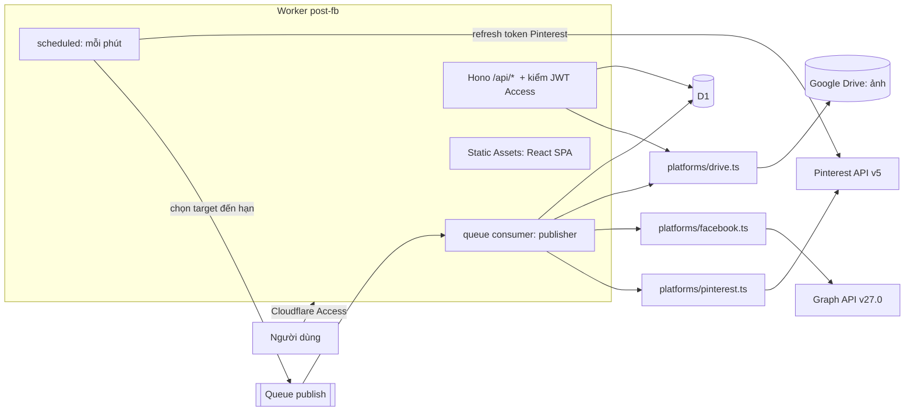
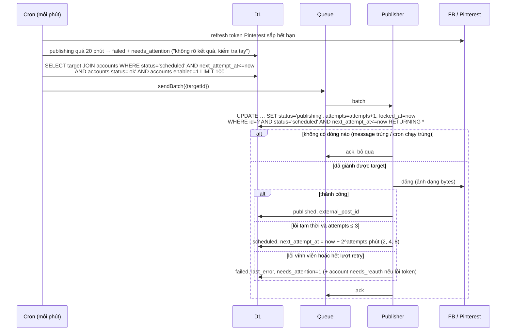

# PLAN — post-fb

Web app đăng bài theo lịch lên Facebook Page và Pinterest Board. Một Worker duy nhất (Hono API + React SPA qua Static Assets), D1 + Google Drive (ảnh) + Cron + Queues, đăng nhập bằng Cloudflare Access.

> **Thay đổi 09/11/2026:** múi giờ lưu **chung cho cả app** trong bảng `app_settings` (migration `0002`, bạn đã duyệt), qua `GET/PUT /api/settings`, nên không còn tự về Bangkok khi đăng nhập ở phiên khác. File CSV mẫu: `web/public/import-mau.csv` (link "Tải file CSV mẫu" ở tab Import CSV).
>
> **Thay đổi 08/11/2026 – lần 4 (Thư viện cho số lượng bài lớn):** `GET /api/posts?group=&page=&q=&offset=` trả 50 bài/trang kèm số bài từng nhóm (Tất cả, Đã lên lịch, Nháp, Lỗi, Đã đăng); nhóm của bài tính trong SQL từ trạng thái các Page; mỗi nhóm có thứ tự riêng (Đã lên lịch: sắp đăng trước, nhóm theo ngày). `POST /api/posts/bulk` xếp khung giờ hoặc xoá nhiều bài, bài nào không làm được thì bỏ qua kèm lý do. Migration `0001_library_indexes` chỉ thêm index `post_targets(post_id, status)` và `post_targets(account_id, status, updated_at)` (bạn đã duyệt).
>
> **Thay đổi 08/11/2026 – lần 3:** (1) **Múi giờ**: chọn ở góc trên giao diện (Bangkok, London, Washington/New York, Chicago, Los Angeles, Sydney, UTC), lưu theo trình duyệt; mọi giờ hiển thị/nhập theo múi giờ đó, có tính giờ mùa hè (`src/lib/time.ts`, dùng chung cho Worker và web). Trình duyệt đổi giờ nhập sang UTC trước khi gửi; CSV import nhận `?tz=`, "Xếp vào khung giờ" nhận `tz` (khung giờ hiểu theo múi giờ đó). (2) **Nhịp đăng an toàn** (`src/lib/pacing.ts`): cách nhau ≥10 phút trên cùng một Page, tối đa 25 bài/Page/24 giờ, cùng nội dung lên nhiều Page thì giãn 30–90 giây/Page + lệch ngẫu nhiên 0–30 giây, cron mỗi lượt chỉ gửi 1 bài/Page; lỗi giới hạn API của Facebook (4, 17, 32, 613, 80001, HTTP 429) chờ 15/30/60 phút; Facebook chặn vì nghi lạm dụng (368) thì tạm dừng Page (`accounts.status = 'paused'`, enum chỉ ở TypeScript, không cần migration) cho tới khi kết nối lại.
>
> **Thay đổi 08/11/2026 – lần 2:** (1) ảnh upload vào thư mục **`post-fb`** trên Google Drive (app tự tạo thư mục; scope `drive.file` chỉ thấy file/thư mục do app tạo); (2) một bài có thể đăng lên **nhiều Page** (`facebookAccountIds`, mỗi Page một target riêng); (3) chọn lại ảnh có sẵn trong thư mục `post-fb` (`GET /api/media`); (4) **Đăng ngay** (`POST /api/posts/:id/publish-now`: đặt lịch = bây giờ và đẩy thẳng vào queue). Xoá/sửa bài **không còn xoá ảnh trên Drive** vì ảnh là thư viện dùng lại.
>
> **Thay đổi 08/11/2026 (bạn yêu cầu):** **bỏ Pinterest**, app chỉ lên lịch và đăng lên Facebook Page; chạy trên **`https://tools.new2h.com`** (custom domain, tắt `*.workers.dev`). Bảng `boards` và cột `post_targets.board_id` vẫn còn trong D1 nhưng không dùng nữa, để không phải chạy migration xoá dữ liệu. CSV giờ có cột `caption,link,image_url,scheduled_at` (cột thừa của file cũ được bỏ qua). Các mục nói về Pinterest bên dưới chỉ còn giá trị lịch sử.
>
> **Thay đổi sau Giai đoạn 6 (bạn yêu cầu):** ảnh upload lưu trên **Google Drive** của tài khoản Gmail cá nhân (OAuth, scope `drive.file`) thay cho R2. Hosting giữ nguyên một Worker. Cột `image_key` giờ chứa id file Drive, nên D1 không đổi schema.

## 0. Đối chiếu tài liệu chính thức (07/11/2026)

| Mục | Giả định trong prompt | Tài liệu hiện hành | Quyết định |
|---|---|---|---|
| Graph API version | không nêu | Changelog ghi bản mới nhất là **v27.0** (bảng phiên bản lại chỉ có tới v26.0, ra 29/07/2026) | Dùng `v27.0`, để trong biến `GRAPH_API_VERSION` của wrangler để đổi không cần sửa code |
| FB Page token "dài hạn" | lưu Page token dài hạn | code → user token ngắn hạn → `fb_exchange_token` → user token ~60 ngày → `GET /{user-id}/accounts` → Page token **không có ngày hết hạn** (bị vô hiệu khi đổi mật khẩu, mất quyền Page, gỡ app) | Không có refresh cho FB. Token chết thì đánh dấu account `needs_reauth` |
| Quyền FB | không nêu | `/{page-id}/photos`: `pages_show_list`, `pages_read_engagement`, `pages_manage_posts`. Trang `/feed` liệt kê thêm `pages_manage_engagement`, `pages_read_user_engagement` | Xin 3 quyền đầu **và `business_management`** (thêm 08/11/2026: thiếu quyền này `/me/accounts` trả 0 Page với Page quản lý qua Business Portfolio). Nếu `/feed` báo thiếu quyền khi test thì bổ sung |
| FB ảnh | không nêu | `/photos`: jpeg/bmp/png/gif/tiff, tối đa 4MB, **PNG tối đa 1MB**. `message` đã deprecated, dùng `caption`. Trả về `id` + `post_id` | Upload chỉ nhận JPEG ≤4MB, PNG ≤1MB. Lưu `post_id` |
| Pinterest token | có access + refresh, refresh trước khi hết hạn | access token **30 ngày**. App tạo sau 25/09/2025 tự dùng "continuous refresh": refresh token **60 ngày, refresh vô hạn**, mỗi lần refresh trả **refresh token mới**, phải lưu lại | Cron refresh khi access token còn < 3 ngày. Luôn ghi đè refresh token mới |
| Pinterest token endpoint | — | `POST https://api.pinterest.com/v5/oauth/token`, HTTP Basic `client_id:client_secret`, form-urlencoded. Sandbox: `api-sandbox.pinterest.com` | Base URL để trong biến `PINTEREST_API_BASE` để chuyển qua lại sandbox |
| Pinterest scopes | — | Trang scopes trả về 404. Trang auth ghi `boards:read`, `pins:read`, `pins:write` | Xin `boards:read,pins:write,user_accounts:read` (`user_accounts:read` để gọi `/v5/user_account`). Có báo cáo trên forum là cần thêm `boards:write`, sẽ kiểm tra lúc test sandbox |
| Pinterest truy cập dữ liệu | — | App đăng ký sau **14/09/2026** có thể nhận `403 PINNER_DATA_ACCESS_DENIED` khi đọc board/pin của tài khoản không phải Business | Dùng **tài khoản Pinterest Business** |
| Tạo Pin | — | Trang reference render bằng JS, không đọc được. Nguồn phụ: `POST /v5/pins` `{board_id, title?, description, link, media_source:{source_type:"image_base64", content_type, data}}` hoặc `image_url` → trả về `id` | Kiểm tra lại bằng Postman collection chính thức trước Giai đoạn 3 |
| Gói test | `@cloudflare/vitest-pool-workers` | README bản 0.23.0 ghi gói này **deprecated**, đổi tên thành `@cloudflare/vitest-plugin` (1.6.0, vitest 4–5). Cấu hình dùng plugin `cloudflareTest()` | Đã đổi sang `@cloudflare/vitest-plugin` + vitest 5 (bạn duyệt ở Giai đoạn 1) |
| Cloudflare Access JWT | kiểm tra header | Header `Cf-Access-Jwt-Assertion`, xác thực bằng `jose` `createRemoteJWKSet(https://<team>.cloudflareaccess.com/cdn-cgi/access/certs)`, kiểm `iss` = team domain, `aud` = AUD tag | Đúng như giả định |

## 1. Kiến trúc



Lý do chọn:
- **Gửi ảnh dạng bytes** (multipart cho FB, `image_base64` cho Pinterest) thay vì URL công khai. Không cần mở route nào ra ngoài Access, không phải ký URL.
- **Trạng thái nằm ở `post_targets`** (một bài × một đích), không đặt ở `posts`. Một bài đăng 2 nền tảng có thể thành công bên này và lỗi bên kia. Dashboard hiện mỗi target là một dòng và lọc thẳng trên `post_targets.status`, không có trạng thái gộp của cả bài.
- **Retry lưu trong DB** (`next_attempt_at`), không dùng retry của Queue. Cron là nơi duy nhất đẩy việc vào queue, nên khi Queue mất message thì phút sau cron đẩy lại.

## 2. Schema D1 (Drizzle, thời gian lưu dạng `integer` epoch ms UTC)

```ts
accounts            // FB: 1 dòng / Page. Pinterest: 1 dòng / user
  id               integer pk
  platform         text  'facebook' | 'pinterest'
  external_id      text           // page_id | pinterest username
  name             text
  access_token_enc text null      // AES-GCM, base64(iv||ciphertext). null = đã ngắt kết nối
  refresh_token_enc text null     // chỉ Pinterest
  access_expires_at integer null  // FB Page token: null
  refresh_expires_at integer null
  enabled          integer 0|1    // người dùng "chọn Page"
  status           text  'ok' | 'needs_reauth'
  updated_at       integer
  unique(platform, external_id)
  // Không bao giờ xoá dòng: post_targets trỏ tới đây (D1 bật foreign key mặc định), và cần giữ lịch sử.
  // Ngắt kết nối = xoá token + enabled=0 + status='needs_reauth'.

boards              // board Pinterest
  id integer pk, account_id fk→accounts (cascade), external_id text,
  name text, enabled integer 0|1
  unique(account_id, external_id)

posts
  id integer pk
  caption text, link text null
  image_key text null             // id file trên Google Drive
  image_url text null             // từ CSV, tải khi đăng
  scheduled_at integer null       // null = draft
  created_at integer, updated_at integer

post_targets
  id integer pk
  post_id fk→posts (cascade)
  platform text
  account_id fk→accounts
  board_id fk→boards null         // bắt buộc khi platform = pinterest
  status text 'draft'|'scheduled'|'publishing'|'published'|'failed'
  idempotency_key text unique     // `${post_id}:${platform}:${account_id}:${board_id??0}`
  attempts integer default 0
  next_attempt_at integer null    // = scheduled_at, hoặc thời điểm retry
  locked_at integer null          // lúc chuyển sang publishing
  external_post_id text null
  last_error text null
  needs_attention integer 0|1
  updated_at integer
  index(status, next_attempt_at)

schedule_slots      // khung giờ lặp lại, theo giờ Asia/Bangkok
  id integer pk, weekday integer 0-6, minute_of_day integer 0-1439
  unique(weekday, minute_of_day)

oauth_states        // chống CSRF, sống 10 phút
  state text pk, platform text, created_at integer
```

**Một nơi duy nhất đổi lịch**: `setSchedule(postId, at | null)` trong `lib/schedule.ts` sửa `posts.scheduled_at`, cùng với `status` (`draft`/`scheduled`) và `next_attempt_at` của mọi target chưa `published`/`publishing`, trong cùng một `db.batch()`. Tạo bài, PATCH, schedule, unschedule và import đều gọi hàm này. Không route nào tự ghi các cột đó.

## 3. Route API (đều dưới `/api`, đều qua middleware kiểm JWT Access, body validate bằng Zod)

| Method | Path | Việc |
|---|---|---|
| GET | `/api/me` | email từ JWT Access |
| GET | `/api/targets?platform&status&from&to` | mỗi dòng là một target kèm bài của nó (cho list và calendar tuần). Lọc trên `post_targets` |
| POST | `/api/posts` | tạo bài + targets |
| GET/PATCH/DELETE | `/api/posts/:id` | sửa và xoá bị chặn khi có target đang `publishing`/`published`. Xoá bài thì xoá cả ảnh trên Drive (lỗi xoá chỉ ghi log) |
| POST | `/api/posts/:id/schedule` | `{scheduled_at}` (ISO có offset) hoặc `{queue:true}` để lấy slot trống kế tiếp |
| POST | `/api/posts/:id/unschedule` | về draft |
| POST | `/api/targets/:id/retry` | "Đăng lại": chỉ khi `failed` và `external_post_id` null. Đặt `attempts=0`, `next_attempt_at=now` |
| POST | `/api/media` | upload lên Google Drive (multipart/related), trả về `key` = id file |
| GET | `/api/media/:key` | xem trước ảnh. `key` là UUID do server sinh, validate bằng Zod |
| POST | `/api/import` | body CSV. 200 `{imported:n}` hoặc 422 `{errors:[{line,message}]}` |
| GET/POST/DELETE | `/api/slots`, `/api/slots/:id` | khung giờ lặp lại |
| GET | `/api/accounts` | accounts + boards (không bao giờ trả token) |
| PATCH | `/api/accounts/:id`, `/api/boards/:id` | `{enabled}`, tức là chọn Page/Board |
| POST | `/api/accounts/:id/disconnect` | xoá token, `enabled=0`, `status='needs_reauth'`. Giữ dòng và lịch sử |
| GET | `/api/oauth/:platform/start` | xoá các `state` quá 10 phút, tạo `state` mới, redirect tới nền tảng |
| GET | `/api/oauth/:platform/callback` | kiểm & xoá `state`, đổi token, lưu với `status='ok'`, redirect về `/#/accounts` |

OAuth callback đi qua trình duyệt của người dùng, trình duyệt đó đã có cookie Access, nên không cần route công khai nào.

## 4. Luồng OAuth

**Facebook**
1. `start`: lưu `state` → redirect `https://www.facebook.com/v27.0/dialog/oauth?client_id&redirect_uri&state&scope=pages_show_list,pages_read_engagement,pages_manage_posts`
2. `callback`: kiểm `state` (tồn tại, < 10 phút, xoá ngay) → `GET /v27.0/oauth/access_token?client_id&client_secret&redirect_uri&code` → user token ngắn hạn
3. `GET /v27.0/oauth/access_token?grant_type=fb_exchange_token&...` → user token dài hạn
4. `GET /v27.0/me/accounts?fields=id,name,access_token,tasks` → upsert mỗi Page vào `accounts` (token mã hoá, `enabled=0` nếu là Page mới). Không lưu user token.
5. UI: người dùng bật Page muốn dùng.

**Pinterest**
1. `start` → `https://www.pinterest.com/oauth/?client_id&redirect_uri&response_type=code&scope=...&state`
2. `callback`: kiểm `state` → `POST /v5/oauth/token` (Basic auth, `grant_type=authorization_code`, `code`, `redirect_uri`) → access, refresh, `expires_in`, `refresh_token_expires_in`
3. `GET /v5/user_account` → upsert account. `GET /v5/boards` (có phân trang `bookmark`) → upsert boards (`enabled=0`)
4. **Refresh**: **chỉ cron** chọn account Pinterest có `access_expires_at < now + 3 ngày` → `grant_type=refresh_token` → ghi đè access + refresh + 2 mốc hết hạn. Lỗi 401 → `needs_reauth`. Publisher không bao giờ refresh. Vì mỗi lần refresh sinh refresh token mới, hai nơi refresh cùng lúc sẽ làm một bên nhận 401. Khoảng đệm 3 ngày là đủ.

**Google Drive (lưu ảnh)**
1. `start` → `https://accounts.google.com/o/oauth2/v2/auth?…&scope=https://www.googleapis.com/auth/drive.file&access_type=offline&prompt=consent`
2. `callback`: kiểm `state` → `POST https://oauth2.googleapis.com/token` → access token (1 giờ) + refresh token → `GET /drive/v3/about` lấy email → lưu account `platform='google'` (token mã hoá).
3. Access token được refresh **ngay lúc cần** (còn < 1 phút), không qua cron: Google không xoay vòng refresh token nên refresh song song vẫn an toàn. Refresh bị từ chối (`invalid_grant`) → account Google `needs_reauth`; bài cần ảnh Drive thì `failed` "Google Drive cần kết nối lại", **không** đánh dấu account Facebook/Pinterest.

**Mã hoá**: `TOKEN_ENC_KEY` là 32 byte base64 → `crypto.subtle.importKey('raw', …, 'AES-GCM')`. Mỗi lần mã hoá dùng IV 12 byte ngẫu nhiên, lưu `base64(iv||ct)`.

## 5. Luồng cron → queue → publish



**Đảm bảo không đăng trùng**
- `idempotency_key` unique trên `post_targets`: một bài × một đích chỉ có một dòng.
- Chỉ đăng khi đã giành được target bằng một câu `UPDATE … WHERE status='scheduled'` nguyên tử. Cron chạy trùng, message lặp, hai consumer chạy song song đều chỉ có một bên thắng.
- Target kẹt ở `publishing` (Worker chết sau khi nền tảng đã nhận bài) **không tự retry**, chỉ chuyển sang `failed` + "cần xử lý". FB và Pinterest không có idempotency key phía server, nên tự retry lúc này có thể đăng trùng.
- Mọi `fetch` ra ngoài (FB, Pinterest, `image_url`) đều có `AbortSignal.timeout(30_000)`. Ngưỡng "kẹt" là 20 phút, lớn hơn thời gian chạy tối đa của một consumer (15 phút). Nhờ vậy không có lệnh gọi nào còn chạy khi target đã bị đánh failed.
- Account có `status='needs_reauth'` hoặc `enabled=0` thì target của nó **nằm chờ** ở `scheduled`, không bị failed hàng loạt. Kết nối lại xong, cron đẩy đi ngay.
- "Đăng lại" bị chặn khi đã có `external_post_id`.

**Phân loại lỗi** (`src/platforms/errors.ts`: `PlatformError{kind:'transient'|'permanent'|'auth', status, code, message}`)
- Tạm thời: lỗi mạng, HTTP 5xx, 429, FB `is_transient=true` hoặc code 1, 2, 4, 17, 32, 613
- Auth (vĩnh viễn, account → `needs_reauth`): FB code 190, Pinterest 401
- Vĩnh viễn: FB code 10 hoặc 200–299, Pinterest 403, các 4xx khác, lỗi validate (thiếu ảnh cho Pinterest, ảnh quá lớn)

**Log**: `log(level, event, fields)` → `console.log(JSON.stringify(...))`. Chỉ log `target_id`, `platform`, `status`, `code`, `message` của nền tảng. Không bao giờ log URL có `access_token`, header, body request.

**Xếp slot (`{queue:true}`)**: lấy các slot theo giờ Bangkok, duyệt 4 tuần tới, lần lượt thử từng thời điểm > now bằng một câu nguyên tử `UPDATE posts SET scheduled_at=? WHERE id=? AND NOT EXISTS (SELECT 1 FROM posts WHERE scheduled_at=?)`. Câu này không đổi dòng nào thì thử slot kế tiếp. Hết 4 tuần mà không còn slot thì trả 409. Sau khi giành được slot, gọi `setSchedule`. Asia/Bangkok cố định UTC+7, không có DST.

## 6. Import CSV

Cột: `caption,link,image_url,platforms,scheduled_at,board`
- `platforms`: `facebook`, `pinterest`, hoặc `facebook|pinterest`
- `scheduled_at`: ISO 8601. Nếu không có offset thì hiểu là giờ Bangkok. Để trống thì bài là draft.
- `board`: tên hoặc id của board **đã bật**. Bắt buộc khi có pinterest.
- `image_url`: https. Bắt buộc khi có pinterest. Ảnh tải lúc đăng.
- Page FB: CSV **không có cột page**, nên dùng Page đang bật duy nhất. Nếu bật nhiều hơn 1 Page thì dòng đó lỗi (xem câu hỏi mở).

Parse bằng papaparse (caption có thể chứa dấu phẩy, xuống dòng, ngoặc kép). Validate mọi dòng bằng Zod và gom lỗi `{line, message}`. Có lỗi thì trả 422, không ghi gì. Không lỗi thì ghi mọi dòng trong **một `db.batch()`** (D1 batch là transaction). Giới hạn 500 dòng mỗi file.

## 7. Cấu trúc thư mục

```
post-fb/
├─ src/                      # Worker
│  ├─ index.ts               # export { fetch, scheduled, queue }
│  ├─ app.ts                 # Hono app, gắn routes
│  ├─ middleware/access.ts   # kiểm JWT Cloudflare Access
│  ├─ db/schema.ts           # Drizzle schema
│  ├─ routes/{posts,media,import,slots,accounts,oauth,targets}.ts
│  ├─ platforms/{facebook,pinterest,errors}.ts
│  ├─ jobs/{cron,publish,refresh}.ts
│  └─ lib/{crypto,csv,slots,schedule,time,log}.ts
├─ web/                      # React SPA (Vite root)
│  ├─ index.html, main.tsx, App.tsx, api.ts
│  └─ components/{PostForm,PostList,WeekCalendar,ImportCsv,Accounts,Slots}.tsx
├─ test/                     # @cloudflare/vitest-plugin
├─ migrations/               # drizzle-kit generate (wrangler d1 migrations apply đọc được)
├─ .github/workflows/ci.yml
├─ wrangler.jsonc, drizzle.config.ts, vite.config.ts, vitest.config.ts
├─ tsconfig.json, eslint.config.js
├─ .dev.vars.example, .gitignore
└─ README.md, PLAN.md, DEPLOY.md (giai đoạn 6)
```

`wrangler.jsonc` sẽ có:
- `assets: { directory: "./dist", not_found_handling: "single-page-application", run_worker_first: ["/api/*"] }`
- `d1_databases`, `r2_buckets`
- `queues.producers` / `queues.consumers`: `max_batch_size 10`. Không dùng dead letter queue: cron là nơi đẩy lại việc, target kẹt có bước dọn riêng
- `triggers.crons: ["* * * * *"]`
- `workers_dev: false`, `preview_urls: false`, để không có hostname nào nằm ngoài Access
- `vars: GRAPH_API_VERSION, PINTEREST_API_BASE, ACCESS_TEAM_DOMAIN, ACCESS_AUD` (redirect URI OAuth lấy từ origin của request, không cần biến APP_URL)

Secrets (`wrangler secret put`, tên được liệt kê trong `.dev.vars.example`): `TOKEN_ENC_KEY`, `FB_APP_ID`, `FB_APP_SECRET`, `PINTEREST_APP_ID`, `PINTEREST_APP_SECRET`. Riêng `.dev.vars` có thêm `DEV_AUTH_BYPASS=1`. Middleware chỉ bỏ qua kiểm JWT khi có biến này **và** hostname là `localhost`.

Frontend dùng Vite thuần build ra `dist/`. Wrangler tự bundle Worker. Lúc dev chạy `vite` (proxy `/api` → `:8787`) song song với `wrangler dev`. Không dùng `@cloudflare/vite-plugin` để `wrangler dev` chạy thẳng được như yêu cầu ở Giai đoạn 6.

## 8. Dependencies

**Runtime**
| Gói | Lý do |
|---|---|
| `hono` | framework bắt buộc |
| `drizzle-orm` | ORM bắt buộc, driver D1 |
| `zod` | validate input bắt buộc |
| `jose` | xác thực JWT Access bằng JWKS, theo ví dụ chính thức của Cloudflare |
| `papaparse` | parse CSV đúng chuẩn RFC 4180 (quote, xuống dòng). Tự viết dễ sai |
| `react`, `react-dom` | UI bắt buộc |

**Dev**
| Gói | Lý do |
|---|---|
| `typescript` | strict |
| `wrangler` | dev, deploy, migrations, `wrangler types` sinh kiểu `Env` (không cần `@cloudflare/workers-types`) |
| `drizzle-kit` | sinh migration |
| `vite`, `@vitejs/plugin-react` | build SPA |
| `tailwindcss`, `@tailwindcss/vite` | CSS bắt buộc (Tailwind v4) |
| `vitest`, `@cloudflare/vitest-plugin` | test bắt buộc. Mock API ngoài bằng `vi.spyOn(globalThis, 'fetch')`, không thêm thư viện mock |
| `eslint`, `@eslint/js`, `typescript-eslint` | lint trong CI |
| `@types/react`, `@types/react-dom`, `@types/papaparse` | kiểu |

Không dùng router (SPA chỉ có vài tab, dùng hash `#/...`), không dùng thư viện calendar/date (lịch tuần tự dựng grid, giờ dùng `Intl.DateTimeFormat` với `Asia/Bangkok`), không dùng thư viện state/fetch.

## 8b. Test tối thiểu (`@cloudflare/vitest-plugin`, D1 thật trong test, API ngoài mock bằng `fetch`)

| Giai đoạn | Test |
|---|---|
| 1 | middleware Access: không có JWT → 403. JWT sai `aud` → 403. Có `DEV_AUTH_BYPASS` nhưng hostname không phải localhost → 403 |
| 2 | CSV: file có 1 dòng lỗi thì trả 422 kèm số dòng, và D1 không có dòng mới nào. Caption chứa dấu phẩy/xuống dòng parse đúng |
| 2 | slot: bỏ qua slot đã có bài. Kín 4 tuần → 409. Giờ Bangkok → UTC đúng |
| 2 | `setSchedule`: unschedule thì target về `draft`, cron không chọn nữa |
| 3 | crypto: giải mã lại ra đúng bản gốc, hai lần mã hoá ra hai IV khác nhau, sai khoá thì lỗi |
| 3 | OAuth callback: `state` sai, hết hạn hoặc đã dùng → 400 |
| 4 | publisher: thành công, lỗi tạm thời (retry, backoff 2/4/8 phút, failed sau lần thứ 4), lỗi vĩnh viễn, lỗi auth (account `needs_reauth`, các target khác vẫn nằm chờ), message trùng / cron chạy trùng (chỉ gọi API 1 lần), target kẹt 20 phút |
| 5 | "Đăng lại": bị chặn khi đã có `external_post_id` |

## 9. CI / CD

- `.github/workflows/ci.yml`: chạy trên `pull_request` và `push` lên `main`. Các bước: `npm ci` → `npm run typecheck` (`wrangler types && tsc --noEmit`) → `npm run lint` → `npm test`. Không dùng secret nào.
- Deploy qua **Cloudflare Workers Builds** kết nối repo:
  - Build command: `npm run build`
  - Deploy command: `npx wrangler d1 migrations apply post-fb --remote && npx wrangler deploy`
  - Lệnh deploy này chạy trên production mỗi lần push `main`. Bạn tự cấu hình lệnh này trên dashboard.

## 10. Việc bạn phải làm thủ công

**Cloudflare**
1. `wrangler d1 create post-fb`, `wrangler queues create post-fb-publish`, rồi gửi tôi `database_id`. Tôi sẽ không tự chạy các lệnh này.
2. Chọn hostname: (a) custom domain trên zone của bạn (khuyến nghị), hoặc (b) `*.workers.dev` dùng tính năng bật Access một chạm cho Workers. Nếu chọn (b) thì phải đổi `workers_dev: true`.
3. Zero Trust → Access → Applications → Self-hosted, hostname ở bước 2, policy Allow theo email của bạn (≤5 người). Ghi lại **AUD tag** và **team domain** (`<team>.cloudflareaccess.com`).
4. `wrangler secret put` từng secret ở mục 7. Tạo `TOKEN_ENC_KEY` bằng `openssl rand -base64 32`.
5. Workers & Pages → Worker → Settings → Builds → Connect GitHub repo, nhánh `main`, điền build/deploy command ở mục 9.

**Meta**
1. developers.facebook.com → Create App → use case "Manage everything on your Page" (Pages API), kiểu Business.
2. Facebook Login → Valid OAuth Redirect URIs: `https://<host>/api/oauth/facebook/callback`.
3. Thêm các thành viên (≤5) làm Admin/Developer/Tester của app. Khi đó app có thể giữ ở **chế độ Development / Standard Access**, dùng được 3 quyền với Page mà các thành viên quản lý, **không cần App Review**. Chỉ khi cần người ngoài vai trò app dùng thì mới phải xin Advanced Access + Business Verification + App Review cho `pages_show_list`, `pages_read_engagement`, `pages_manage_posts`.
4. Copy App ID và App Secret, đặt bằng `wrangler secret put`.

**Pinterest**
1. Dùng hoặc chuyển sang **tài khoản Business**.
2. developers.pinterest.com → Create app → Redirect URI `https://<host>/api/oauth/pinterest/callback` (và `http://localhost:8787/...` cho dev).
3. App mới ở mức **Trial access**: test bằng sandbox (`PINTEREST_API_BASE=https://api-sandbox.pinterest.com`). Để Pin hiện công khai trên production phải xin **Standard access** (có thể bị yêu cầu video demo). Việc này nên làm sớm vì nằm trên đường găng.

## 11. Rủi ro đã biết

| Rủi ro | Ảnh hưởng | Giảm thiểu |
|---|---|---|
| Pinterest Trial → Standard bị chậm hoặc bị từ chối | không đăng Pin công khai được | xin sớm. Dev và test hoàn toàn trên sandbox |
| `403 PINNER_DATA_ACCESS_DENIED` (app sau 14/09/2026) | không đọc được board | dùng tài khoản Business |
| Meta App Review / Business Verification | chỉ khi có người dùng ngoài vai trò app | giữ ≤5 người trong vai trò app |
| FB Page token bị vô hiệu (đổi mật khẩu, mất quyền admin) | đăng lỗi `190` | `needs_reauth` + banner "kết nối lại", bài chuyển failed để đăng lại |
| Pinterest refresh token không được refresh trong 60 ngày | phải OAuth lại | cron kiểm mỗi phút, refresh khi access token còn < 3 ngày. Access token 30 ngày nên thực tế refresh ~mỗi 27 ngày |
| Token hỏng khi đang có nhiều bài xếp hàng | nhiều bài lỡ giờ | bài nằm chờ ở `scheduled` (không failed), banner "kết nối lại". Kết nối xong thì bài đi ngay, nên có thể trễ giờ |
| Rate limit: FB Page có giới hạn theo Page (BUC), Pinterest Trial ~1000 call/ngày | 429 | xếp vào lỗi tạm thời + backoff. Cron lấy tối đa 100 target mỗi phút |
| Worker chết giữa lúc đăng | không rõ đã đăng chưa | không tự retry, đánh dấu "cần xử lý" (chấp nhận thay vì đăng trùng) |
| Ảnh FB: PNG >1MB, ảnh >4MB | lỗi 4xx | validate lúc upload. Ảnh từ CSV kiểm kích thước lúc tải |
| `image_url` trong CSV chết hoặc chậm | lỗi khi đăng | timeout 15s, coi là lỗi tạm thời. Hết lượt retry thì failed kèm lý do |
| Cron chậm | lệch giờ | cron mỗi phút + queue ngay, nên lệch dự kiến < 2 phút. Test bằng `wrangler dev --test-scheduled` |
| Trang tài liệu create-pin không đọc được | sai body request | kiểm bằng sandbox trước khi chốt `pinterest.ts` |

## 12. Câu hỏi mở (cần bạn trả lời khi duyệt)

1. Số người dùng: 1 người hay nhóm ≤5? Prompt còn để placeholder. Thiết kế không đổi, chỉ đổi policy Access và vai trò Meta app.
2. CSV không có cột Page FB. Đồng ý quy tắc "dùng Page duy nhất đang bật, nếu nhiều Page thì báo lỗi dòng" không? Hay cho thêm cột `page`?
3. Hostname: custom domain (zone nào?) hay `workers.dev`?
